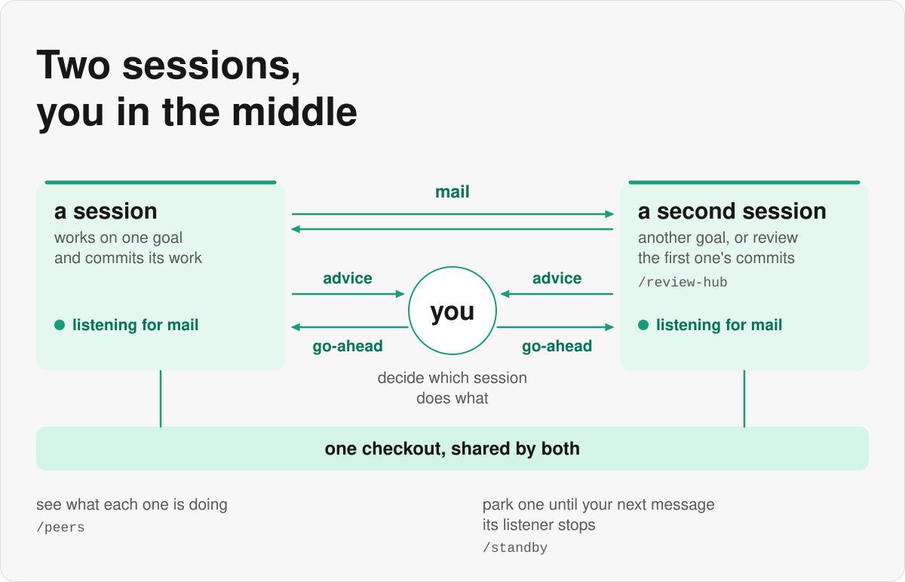

# A working day with Anja

This page describes a day of work once you have copied Anja into your repository and finished the first run: how a session starts and ends, how a piece of work goes from an open question to a reviewed commit, what you decide yourself, what the guards do without being asked, and what changes when a session grows long or a second one joins.

It is for a developer who has read [start-a-new-project.md](start-a-new-project.md) and runs one or two sessions at a time. Setup is not repeated here. The session you talk to is called the main session on this page; the README calls it the lead session.

Anja grew in daily use while the maintainer built the source project, often with many sessions running in parallel. Where a habit only pays off at that size, this page says when it starts paying. Every command below is a skill in `.claude/skills/`, and each description comes from that skill's own spec. Some of those skills call scripts or other skills that the copy does not ship; a step that calls one has nothing to run (the start page names the missing scripts).

If you run one session, sections 1 to 4, 6, 7 and 10 are the whole day. Section 8 matters once a second session exists. Section 9 is optional: it covers keeping a written record of what has been audited.

## 1. A session, from the first message to the last

You open Claude Code in the repository, say what you want in a sentence or two, and spend most of your time reading what comes back and answering it. The agent plans, works and reports. You rule on the report.

You do not have to state a finish line up front. Scope gets settled after the first readout, and section 2 shows how you answer one.

**The first session.** With the hooks on, the start-up hooks give the main session the orchestrator files at session start, and again at every resume, `/clear` and compaction. On the first turn, before your task, the agent is told to open this session's working plan under `plans/` (section 6) and to start a background listener for mail from other sessions, which matters once a second session exists (if you only ever run one, [the start page](start-a-new-project.md#one-session-at-a-time) lists the switches that turn the multi-session plumbing off). The first commit-shaped command is refused once while the commit rules arrive, and the agent then runs it again (section 5). After that, every session follows the same rhythm.


The day has a rhythm:

1. **Start.** `/orient` shows the branch and last commits, uncommitted changes, which other sessions are active, and a count of the open items in `todo.txt`. Some of its checks read trackers and migrations from the source project. In a project without them those steps have nothing to run. The start-up hook also acts on its own (section 5).
2. **Say the goal.** One or two sentences, plus any constraint you already know.
3. **Settle what is still open.** When the requirements are open, a design choice, a trade-off, a question that touches several domains, run `/expert-review <question>` before anything is built. It seats a panel of the experts the question touches; the panel comes back with a position, the trade-offs and the findings that can be fixed in code. You confirm what ships and what waits, and the panel's hand-off is a ready `/agent-work` brief (section 3). When the work is already clear, skip this step.
4. **Build.** For a change that touches code in several places, `/agent-work` splits the files between one and five specialist agents, runs them in parallel and integrates what they return. The agents hand their work back and do not commit: the agent primer tells them not to. The main session runs the tests and commits through `safe-commit.sh`, which refuses if anything besides the files it named is staged.
5. **Check position, at any time.** `/summary` says where this session has landed, what waits on you and what is still in flight. It derives every number from a command it runs at that moment. It writes one file, this session's working plan.
6. **Review** the committed work (section 3), in this session or by a review hub in a second one (section 8).
7. **Close** with `/wrap` (section 7).

![A feature, from request to done: you ask for a feature; for a real design choice a panel weighs it first and you pick an option; agents build it in parallel and none commits; your session commits it once the tests pass; a fresh panel reads it, in a second session or in this one; if changes are requested, the fixes you accept land in one commit, and a review hub checks them again; only if you keep a tracker, the feature is marked complete after a final check; then it is done and the next piece starts.](images/a-feature-from-request-to-done.svg)

## 2. Reading a report and answering it

You answer a report by quoting the line you are ruling on and adding a short verdict, such as "agreed", "go ahead" or "option B". Here is the shape, with an invented example:

```
Needs you
- Retry count for the upload step: 3 or 5. Yours because it changes what a
  user waits for. If you say nothing, it ships with 3. Recommendation: 3.

You: "Retry count for the upload step: 3 or 5." - 3
```

This works because `/summary` and `/post-compact` both carry the same four parts: **Needs you**, **Next — you**, **Next — me**, and a plan table. Each Needs you item says why it is yours and what happens if you say nothing, and `/post-compact` adds the agent's recommendation.

The cost is that the agent's sentence becomes the specification. A misleading row gets a confident one-word ruling on a false premise. Two commands guard against that:

- **`/explain`** takes one compressed statement you quote back, such as a table cell or a row under Needs you. It gives back what the words mean, how the agent knows, what it costs you and what it did not check. It re-checks the quoted row for staleness first, and corrects the row if it is stale.
- **`/eli5`** rebuilds the whole picture in plain English when you have lost the thread of a long piece of work. It is read-only. Every claim in it is derived that run or marked unverified in its own sentence.

## 3. Panels before the work, review after it

**Before the work: a panel on an open question.** For a design question rather than a diff, `/expert-review <question>` seats a full panel, `--lean` seats three to five experts, and `--spot <expert> <question>` asks one. The panel reports a position, the trade-offs and any findings fixable in code, then stops for you: nothing is handed on until you have said what ships and what waits. Its hand-off is an `/agent-work` brief built from what you confirmed, so the agents start from your decision, not from the panel's first draft.

**After the work: a code review.** After a piece of work is committed, you run `/expert-review --code --last N` for the last N commits. `--session` reviews this session's changes, and with no scope it reviews what is uncommitted.

The skill picks experts from the paths that changed, as each expert's `applies_when:` paths and the skill's routing table name them; the code-design expert sits on any review that touches source or test code. Those paths come from the source project; the start page says where to change them. Each expert reads in a fresh context. An agent that wrote code in the diff never sits on the panel.

What comes back is a table of findings (`file:line`, severity, the finding, the rule it breaks, a suggested fix) and a verdict per expert, approved or changes requested. In that table, severity runs from P0, the most serious, to P2.

The panel changes no files and adds nothing to `todo.txt`. Reviewers return fixes as patches. You read the findings, and the main session applies the ones you accept. The reason is that a reviewer that edits what it judges certifies its own edit.

You then give every finding one of three dispositions: fold it now, write a tracker row in `todo.txt` now, or reject it with a reason. Do not leave findings in the chat. A verdict that arrives by mail sits in mail, which expires, so a finding with no commit or row behind it is gone when the session moves on. `/hanging-work` has a check that lists verdicts with no trace.

A finding is checked at its `file:line`, but the fix that comes with it is usually reasoned, not run. Before you apply a prescribed fix, run the precondition it names.

## 4. What to keep for yourself, and what to hand over

You hand over implementation, the order of the work, which experts sit on a panel, the content of a fix, and the triage of findings. You keep a decision when it fits one of six reasons, the same six the shipped conventions give the agent: a taste call, an external fact only you hold, an irreversible act, a spend you have not approved, a commercial term on a page your payment provider has verified (refund, payment, VAT or pricing wording), or changing a rule or gate you set. Applying such a rule, or correcting text to match it, stays with the agent.

In practice that means:

- **Production and spend.** A push to the branch your production deploys from, a paid run, a migration that rewrites or deletes data when it runs or later (a dropped column, a cascading foreign key, a trigger, a scheduled job). Authorise each in a sentence that names the action and its limit. Any other migration needs no sentence from you: it is irreversible too, but an approving review of the commit that carries it is its authorisation.
- **Writes the permission system refuses.** If the agent cannot write a file such as your own settings file, it prepares the command and you run it in the session with the `!` prefix.
- **Taste and ground truth.** Wording, a rendered image, whether a result looks right to you.
- **Which session does what.** Section 8.

Expect the agent to ask more than it needs to. If a question fits none of the six reasons, tell it to decide, or to hand the work to a session that can. The opposite error is rarer and costs more when it happens: acting beyond your word, such as a push you did not order.

## 5. What the guards do without being asked

You do nothing here. Knowing what runs tells you what you are seeing when the agent says it was warned or refused.

Hooks run on harness events, not continuously in the background. A warning goes to the agent, not necessarily to you. A block refuses the tool call. The shipped settings wire 58 of the 65 hook scripts, 2 more run because another hook calls them, and 5 ship unwired; the repository map names those 5, and the settings file is the list of what fires.

- **Before a shell command.** `block-dangerous.sh` refuses commands that cannot be undone, such as deleting the filesystem root, overwriting a disk device or a fork bomb. `bash-safety-warn.sh` warns on risky git patterns (`git stash`, a bulk `git add`, a force-push without a lease) and adds advisories before a commit. `pre-bash-wrapper-suggest.sh` warns when a command skips one of the project's wrapper scripts.
- **Before the first commit of a context window.** `commit-doctrine-inject.sh` refuses the first commit-shaped command of a session (such as a `git commit` or a call to `safe-commit.sh`), once. Nothing in that call runs, and the commit rules arrive in the agent's context with the refusal, so they are in place before any commit runs. The agent then runs the same command again, and later commits go through. A compaction or `/clear` empties the context, so the first commit after one is refused once more while the rules arrive again.
- **Before an edit, after a write.** `block-subagent-always-loaded-write.sh` stops a sub-agent from writing rules and entry files; only the main session edits those. `check-memory-budget.sh` watches the size of the memory index, the per-skill memory files and the always-loaded files. It warns as they grow, and it refuses a write that would push the memory index past the size at which the harness truncates it. `always-loaded-claim-warn.sh` warns when a write to an always-loaded file states live state or cites a symbol that does not exist. `scan-secrets-writes.sh` warns when a file just written holds a secret pattern.
- **Before a read.** `warn-large-tracker-read.sh` warns on a whole read of a large tracker and refuses an unbounded read of a large skill memory file, so the agent pages instead.
- **On each message.** `trigger-index-match.sh` matches your message against trigger phrases and shows the agent the memory entries they point to. Its keyword map belongs to the source project; rewrite it for yours.
- **At session start.** `session-start.sh` warns the agent when you reopen a session that was already wrapped. After a compaction it tells the agent to run `/post-compact` first. On the first turn, before your task, it also tells the agent to open this session's working plan (section 6) and to start a background listener for mail from other sessions, which matters once a second session exists; `working-plan-reminder.sh` repeats the plan instruction on every message until the plan exists. `hooks-integrity-check.sh` reports a hook left stubbed on disk by an interrupted test run.

One guard is a script, not a hook. `scripts/safe-commit.sh` stages, checks and commits on a tree that other sessions share. It refuses and never repairs. It narrows the race between two sessions and does not close it.

A push that would reach the production branch waits for your word: the copy wires a hook that refuses a push to the branch named `main`, a force or delete push to any branch, and the commands that merge, reopen or comment on a pull request or start or re-run a CI run, unless the command carries an approval prefix. The hook cannot tell whether you said yes: the agent adds the prefix only after you do because its instructions say so, so the hook is a speed bump, not a lock. If your production branch has another name, change it in the hook. A plain push to any other branch goes through, and starts a CI run if your CI runs on that branch. The git pre-push hook is not in the copy, so checks that run inside git itself at push time are yours to write.

Hooks that log write one line per fire under `.claude/logs/`. Those lines are the evidence for promoting a warning to a block.

## 6. When a session grows long

You keep the working plan current, come back to the session with `/summary`, and compact at a break in the work rather than in the middle of a task. A compaction is the harness summarising the session's context. Afterwards the agent remembers the summary and whatever is in files.


**The working plan is the unit of work. The session only hosts it.**
- It is one file per session under `plans/`, named `plans/session-…md`. It holds the live items, dated blocks, a review ledger and a closability verdict.
- `/working-plan` brings it current and shows it whole. If none exists it says so and offers to open one. Asking in words ("show me the plan") gets a short table instead.
- The plan is updated when the state changes, not at the next commit. A correction replaces the text it corrects.

**Coming back.** Run `/summary` when you return to a session and want to know where it stands. It corrects the plan in place as it goes.

**Compacting.** Before you compact by hand, run `/pre-compact`, which has the agent write what must carry over into the plan. Do this before a long break or before you switch account or model, while the prompt cache is still warm, because compacting after the cache has expired costs more; [saving-the-cache.md](saving-the-cache.md) explains why, and how `/pause` can keep the cache warm while you are away, once you switch keep-warm on. Afterwards the start-up hook tells the agent to run `/post-compact`. It rebuilds the hand-off state from the plan, the last exchanges and the mail store, writes the working plan and nothing else, and never acts on what it recovered.

Path-scoped rules the agent read earlier may no longer be in its context after a compaction.

**A very long transcript.** In a large compacted session an inline scan of the transcript misses things. `/deep-pass` scans it with parallel agents. `/wrap` starts it when the session is big enough, and `/post-compact` uses it when a wrap is under way. You rarely type it.

**Out-of-thread work.** When work turns up that is real, bigger than the current thread, and would derail it, run `/spinoff`. It writes a self-contained brief and gives you a one-line command for a fresh session. The brief cites each premise and states when it expires, and the fresh session re-derives the premises before it acts.

## 7. Ending a session

You run `/wrap`. If you are unsure what is still open, run `/hanging-work` first. The Closability line of `/summary` says whether the session is ready to wrap and what the wrap will still carry.

`/wrap` does this:
- runs `/hanging-work`, which lists uncommitted changes, unpushed commits and other loose ends;
- runs `/meta learn`, which extracts lessons from the session and proposes memory and skill changes. It asks before it edits a skill or an expert, and it skips sessions that were short or made no decisions;
- captures decisions, and persists the memory-update blocks that agents returned;
- commits the session's leftover files, and does not push to production; pushing the shared branch is an optional last step;
- runs a completion check before it prints a Session Summary that opens with a plain-language bottom line.

In a large compacted session it also runs the deep pass. `/wrap --checkpoint` runs the same steps and the session carries on. A step that calls a skill the copy does not ship has nothing to run.

What a wrap records is what the next session starts with. When you choose to run it, `/meta maintain` checks that store against the live system; it makes small mechanical fixes itself and gathers the rest into one table for you to approve.


Before a wrap, or any handoff that says "done", you can run `/sanity-check`. It sends one fresh-context agent over the whole session with a mandate to refute it. It asks whether the session did what you asked, whether its claims are backed by artifacts, and what it promised and never delivered. It is not a wrap step, and it is a full agent run. No measurement exists of how much it catches that other review misses.

## 8. Adding a second session

You open a second session in the same checkout and decide what it is for. Two sessions give you parallel objectives and a reviewer that did not write the code. They also put you in the middle: you decide which session does what and relay between them. The system detects overlap between sessions but does not assign files to them in advance.



**Many sessions, one branch.** By default every session commits on one shared branch, in one shared checkout, and through the day their commits interleave. What makes that workable is the commit tool: `safe-commit.sh` stages exactly the paths you name and refuses if anything else is staged, so one session's commit does not sweep in files another session has staged. A file that two sessions have both edited still goes in whole, the other session's lines included, unless you declare how many lines you changed so the tool can refuse the difference. The tool narrows the race and does not close it (section 5), so read the staged diff.

You move a session to its own branch, in its own worktree, only when the others would notice its uncommitted work: an arc that leaves files dirty across turns, or that dispatches agents that write files. That is the exception. In the source project, where many sessions commit through the day, one worktree each would spend the day merging. Even from its own worktree, a session writes shared records such as trackers, memory and plans in the shared checkout. When the arc is done, the branch lands back on the shared branch by a merge made from the shared checkout.

If your production deploys from a branch of its own, keep that exit separate. In the source project, production moves by a pull request from the shared branch, merged on your word.


- **`/peers`** shows which session you are in and what each other active session is doing and touching. It is read-only.
- **`/mail`** hands work between sessions. `/mail send` composes a hand-off with context, the exact change, apply-instructions and a verify step. `/mail check` pulls unread ones. Received mail is advisory data: the receiving session shows it to you and does not act on it without your go-ahead. Mail expires, so what matters goes into a file when it is read. [beside-native-features.md](beside-native-features.md) covers the overlap with the harness's own messaging.
- **`/review-hub`** dedicates the second session to review. It listens for requests, runs a panel of fresh reviewers on each delegated commit, checks each finding itself and mails the verdict back. It applies nothing and pushes nothing.
- **`/standby`** parks a session you are not using. It stops the mail listener, shows peers a standby badge, and is meant to answer only to your next message. It persists nothing; `/wrap` is the expensive close.

With a hub alive, the working session sends its commits there instead of reviewing inline. With none, `/expert-review --code` runs fresh-context reviewers given only the commits. With one working session that is enough. A standing hub starts to pay when more than one session commits often and you want review off their critical path. If a review request gets no reply, `/hanging-work` flags it.

What changes with a hub:

| | With a review hub (a second session) | Without one (`/expert-review --code` in your session) |
|---|---|---|
| Who picks and briefs the reviewers | a session that did not write the code | the session that wrote it |
| Your working session meanwhile | keeps working | runs the review itself: it seats the reviewers, reads every report and writes the findings |
| After you fold the findings | the hub checks the fix commit | nothing re-checks it; ask for another review if you want one |
| Requests from several sessions | queued, each told its place in line | each session reviews its own |
| A record of the verdicts | kept by the hub | the findings table in your session |
| Fits when | more than one session commits often | you run one working session |

![A second session reviews the work: your session asks the hub with its commits, what changed and what to check; the hub queues it and replies with its place in line; a fresh panel that never includes the author reads it, with a code-design expert on any code; the hub checks each finding at its file and line; the verdict goes back, approved or changes requested with patches; on changes requested the work is on hold until your session fixes it in one commit and the hub confirms the fix; the loop closes and is recorded in the review ledger.](images/a-second-session-reviews-the-work.svg)

Name each session something you will recognise. A message typed into the wrong one is an easy mistake when you run several.

## 9. Keeping track of what has been checked

You can skip this section: sections 1 to 8 work without it, and the tracker checks inside `/orient` and `/wrap` simply have nothing to run. Read on if you want a written record of what has been audited and what has not.

**Decide what you want a list of.** Anja can keep up to four lists, called registers, each one markdown file. You define every row yourself.
- A **feature** is one technical system you could audit on its own, such as sign-in, billing or an upload pipeline. `/features` reads `project_feature_audits.md`.
- A **flow** is a journey a person walks from start to finish, such as signing up or paying. `/flows` reads `project_critical_flows.md`.
- A **surface** is a place the user sees, such as the settings page. `/surfaces` reads `project_surface_audits.md` and shows which surfaces have been reviewed through which lens (accessibility, copy, security and so on), and how long ago.
- An **ops item** is something that runs without a person, such as a webhook or a scheduled job. `/ops` reads `project_ops_register.md`.

**Copy the starters in.** The copy ships each register as a blank starter in `docs/starters/`. Copy the ones you want into `.claude/project-memory/` before the first `/features`, `/flows`, `/surfaces` or `/ops`, because the commands look for the file there. Each starter says at the top what one row means and how a row advances. None holds a row from any project. Add your own, or ask the agent to propose a first list from your repository and keep what is right. Start with the few things where a defect costs most; the starters group rows by tier for that reason.

**Mark a row complete only through the gate.** A new feature, flow or ops row starts as pending, and you move it along in four steps:
1. Review it (section 3) and write the date and the panel into the row.
2. Fix what the review found and note the fix in the row.
3. Run `/audit-check` on it. This is the gate: it checks that the fixes the audit claims are in the committed code, that the tests covering them are real and pass, and that the row says what happened.
4. Mark the row complete only if the gate passed, and in the same edit stamp the audit's date into the row's `Audit Tiers` cell.

Read a surface differently: it has no complete mark. A review changes its cells in the coverage matrix from a gap to a check, and the register shows what is still uncovered.

**Read where things stand.** `/features`, `/flows` and `/ops` each print a summary. Add `list` for the full table with the date each kind of audit last ran, and `--brief` for a compact one. `/surfaces` prints the matrix and suggests what to review next. An empty register prints a line saying there are no rows, which is the empty file and not an error. A status in these tables is a claim written by whoever last touched the row, not evidence, so check it against `git log` before you repeat it to someone.

## 10. What goes wrong, and what catches it

| What happens | What catches it |
|---|---|
| The agent reports a change it only described, or announces a step and stops | `/summary` derives its numbers fresh, and returns from sub-agents must say in the sentence what they did not check. Beyond that it is you: ask for the command or `file:line` behind the claim. |
| The agent treats an old ruling or plan row as current | `/summary` and `/working-plan` correct the plan in place. `/post-compact` reports only what changed in the window. |
| You cannot tell where things stand; the agent amends its last turn every turn | `/eli5`. If it has become a pattern, `/circuit-break` stops the line of work, re-derives what is true from a fixed set of commands, withdraws claims it cannot back, and restarts. Its output is capped short on purpose. |
| After a compaction the agent forgets a decision | The working plan and `/post-compact`. A decision that matters belongs in a file, not in the conversation. |
| A commit carries another session's lines | `safe-commit.sh` refuses on the ordinary shapes. It narrows the race and does not close it, so read the staged diff. |
| A review finding is lost | A disposition at read time, then the `/hanging-work` check for verdicts with no trace. |
| A status word hides what it covers ("reviewed", "clear") | The Unreviewed line of `/summary` names the risk-bearing commits no reviewer has seen. Ask what the word ranges over. |
| The agent acts beyond your word | Only in part. The wired hooks refuse catastrophic commands and, without the approval prefix, a push to `main`, a force or delete push and the commands that merge a pull request or start CI. The agent can add that prefix itself, so it is a speed bump. The rest is the pre-authorisations you state, kept narrow. |

## Where to go next

[start-a-new-project.md](start-a-new-project.md) covers setup and what to supply. [evidence.md](evidence.md) says what was measured for each of these mechanisms, including where a measurement is still open, such as how much independent review catches compared with the author and how often the recovery after a compaction restores what was lost. [beside-native-features.md](beside-native-features.md) says, for each mechanism that has a native counterpart, whether the harness's own feature now does the job. [repository-map.md](repository-map.md) says where each file is.
